# Altium SchLib 符号编辑器

Altium Designer 的原理图符号可以给同一个器件准备多种显示模式，用来适应不同画法。例如光耦可以把发射端和接收端画在一起，也可以拆开；继电器可以把线圈和触点画在一起，也可以分开；双刀双掷继电器还可以把两组触点拆成两个部分。这些都是合理的库设计。

Altium 自己管理这些显示模式却比较费劲：

- 必须逐个点开器件，再打开 Mode 菜单，才能知道它有没有第二种、第三种画法。
- 软件自带的规则检查只针对当前切到的那一种显示模式。其它模式里的错引脚、旧图形，不切过去就发现不了。
- 新建器件时经常复制一个旧符号、改名再编辑。旧符号里没用的显示模式如果忘了改、忘了删，就会留在库里。
- 调整显示模式的先后顺序只能手工复制粘贴。器件有多个 Part 时，每个 Part 都要再做一遍。

这个工具用来把这些隐患一次看清，并直接改掉。它只关心带多种显示模式的符号，在一个窗口里对照全部模式和全部 Part。

Altium 里同一个符号的 Mode 菜单通常长这样。程序里的模式名称与之一致：没改过名的显示为 Normal、Alternate 1、Alternate 2；在 Altium 里改过名的，显示文件中的自定义名称。界面可以在中文和 English 之间切换。

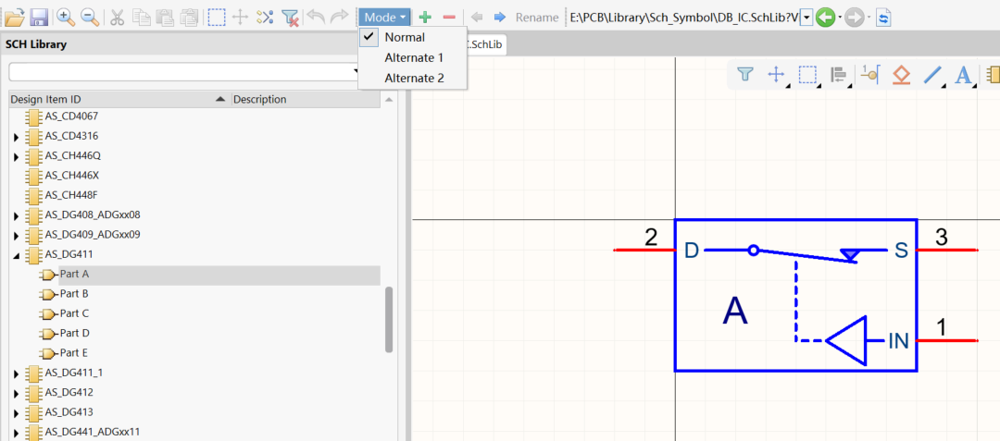

## 主要功能

1. **核对引脚编号和名称。** 同一种位号在各个显示模式里名称不一致时，这一行会标红，可以一次改成同一个名称。
2. **调整显示模式顺序。** 在模式标题上右键，左移或右移一下就完成，不用再复制粘贴。
3. **删除不需要的显示模式。** 所有模式横向排开，同一个模式里的多个 Part 纵向排开。看清楚再删。
4. **检查重复引脚和不该隐藏的引脚。** 目前只允许名称为 `NC`、`nc`、`.n.c` 的引脚设置为不可见。这三个名称写在 `issues.py` 的 `HIDDEN_PIN_NAMES` 里，以后要增减，只改这一处。
5. **显示和修改模式名称。** 文件里有 `CustomDisplayModeName` 就显示这个名称，没有就显示 Normal、Alternate 1、Alternate 2。在模式标题上右键可以自定义名称或复位名称。左移、右移时，自定义名称跟着模式走。

另外还会检查各模式的引脚数量是否一致、位号是否为空、同一模式里位号是否重复。检查不区分 Part，只按显示模式汇总。

## 运行

需要 Windows 和 Python 3.10 或更高版本。

```bat
python -m pip install -r requirements.txt
python gui.py
```

也可以打包成单个程序：

```bat
python build_exe.py
```

打包时版本号末位加一，生成的文件在 `release` 目录，名称类似 `Altium_Schlib_Symbol_Editor_v1.0.0.1.exe`。

写回 SchLib 之前，先关闭正在打开这些库的 Altium Designer。程序独占库文件，Altium 开着时保存会失败。

## 打开库

- **打开 SchLib**：打开一个库，只列出其中有多种显示模式的符号。
- **打开文件夹**：列出该文件夹里的全部 `.SchLib`，不进入子文件夹。打开多个库时，列表会多出一列文件名。
- **筛选**：按符号名或文件名缩小列表。
- **仅显示有问题的符号**：勾选后只留下检查有问题的符号。
- **关闭文件**：如果还有未保存的修改，会询问是否保存。

窗口标题是 `Altium_Schlib_Symbol_Editor` 加版本号。还有未写入文件的修改时，标题末尾会出现 `*`。底部状态栏会汇总符号数量、有问题的数量，以及尚未保存的数量。

列表打开后默认停在 **编辑** 页。左侧是符号，中间是引脚名称，右侧同时画出全部显示模式。

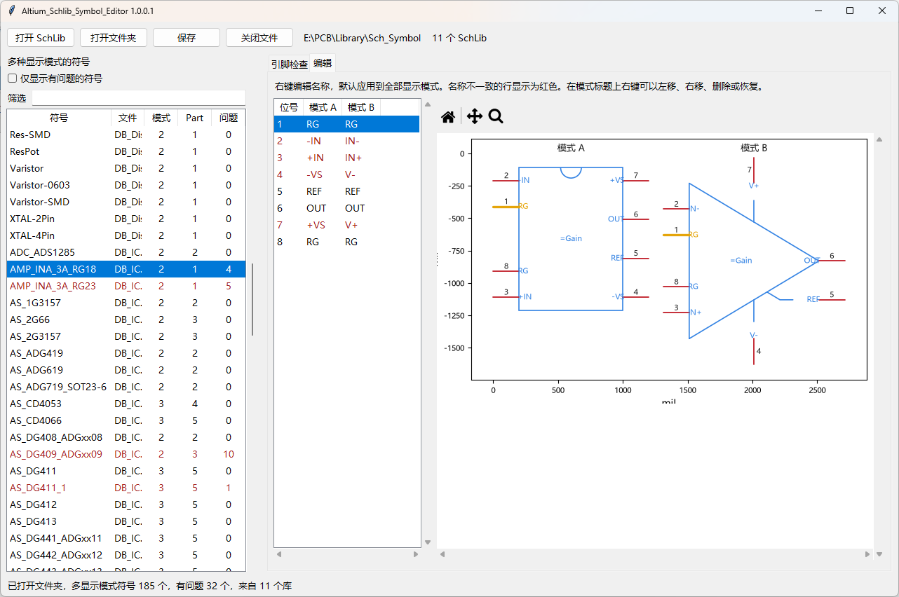

上图里 `AMP_INA_3A_RG18` 有 4 个问题。引脚 2 在模式 A 叫 `-IN`，在模式 B 叫 `IN-`，所以这一行是红色的。右侧把模式 A 和模式 B 画在一起，可以直接对照。

## 1. 修改不一致的引脚名称

在 **编辑** 页，表格只有位号，以及每个显示模式一列名称。同一个位号只占一行，不按 Part 拆开。某一列没有这个位号，或者同一模式里这个位号出现了不同名称，这一行都会标红。

在名称上右键：

- 选择已经出现过的名称，空名称显示为「（空）」。
- 选择 **自定义名称...**，输入一个新名称。

默认会把这个位号在全部显示模式、全部 Part 上的名称改成同一个值。位号本身不变。

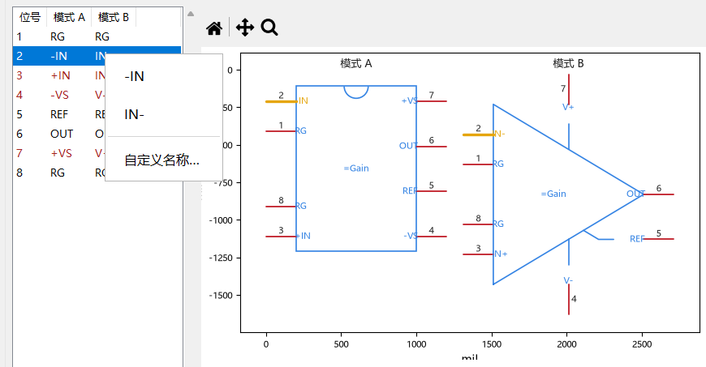

改完后红色消失，问题数也随之减少。图形里的引脚名会一起更新。此时修改还在内存里，符号名后面的 `*` 表示还没有写入文件。

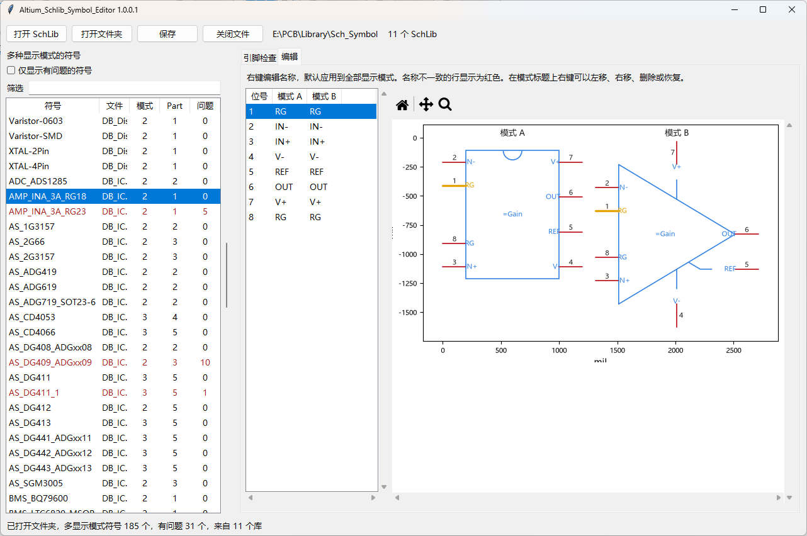

**引脚检查** 页可以看完整说明，类别包括引脚数量、引脚名称、重复引脚和隐藏引脚。默认勾选「只看当前符号」。

## 2. 调整显示模式顺序

右侧预览把各个显示模式从左到右排开。一个模式里有多个 Part 时，这些 Part 从上到下排开，所以多 Part 器件也不用来回切换。

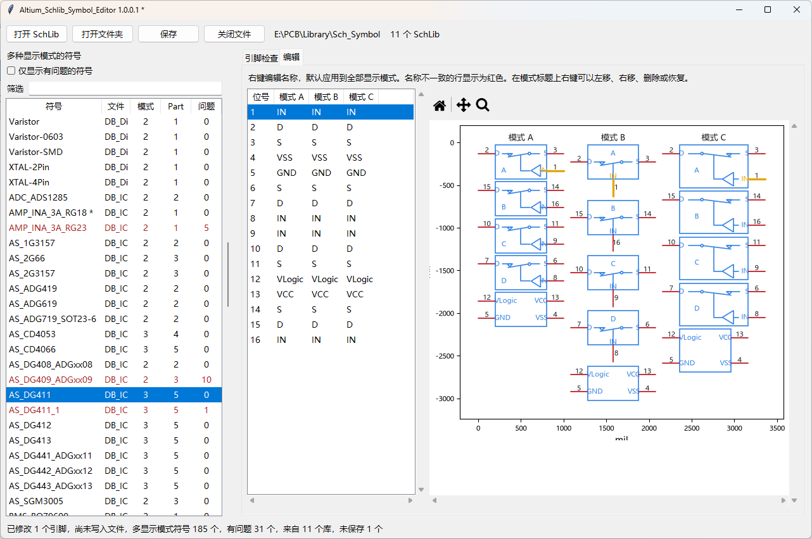

在表格的模式标题上右键：

- **左移**、**右移**：和相邻模式交换，点一下立即生效。自定义名称会跟着这个模式走。最左边不能再左移，最右边不能再右移。
- **删除**：删掉这一列对应的显示模式。
- **自定义名称**、**复位名称**：给这个模式写一个名称，或删掉自定义名称、回到 Normal / Alternate N。
- **恢复**：回到这次开始调整显示模式之前。那之后对这个符号做过的顺序调整、模式改名和引脚修改会一并撤消。

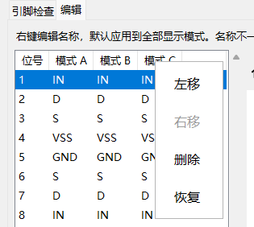

下图是把原来的模式 B 左移之后的结果。原来的 B 变成了 A，原来的 A 变成了 B，模式 C 不动。多个 Part 会一起跟着走，不需要逐个粘贴。

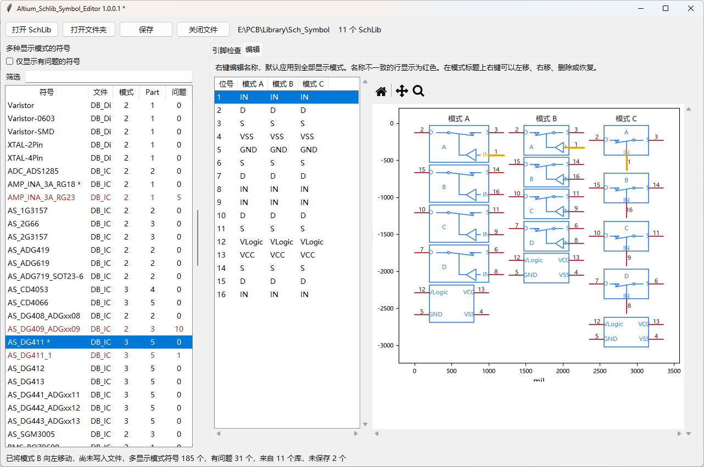

## 3. 删除显示模式

删除前先在预览里确认要去掉的是哪一种画法。下图的 `AS_DG412` 仍有模式 A、B、C。

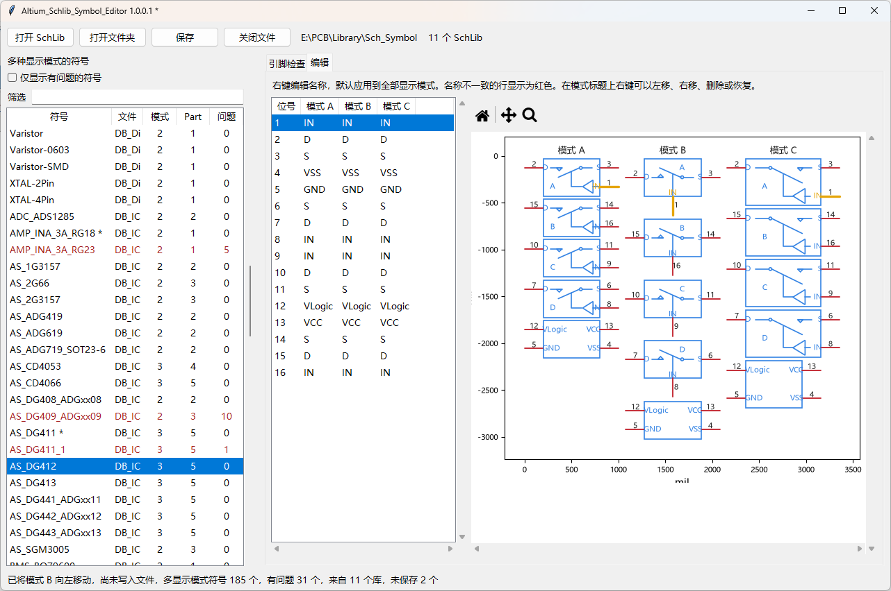

在要删除的模式标题上右键，选择 **删除**，确认后执行。只剩一种显示模式时不能再删。删掉前面的模式后，后面的模式会依次前移，并重新标成 A、B、C。

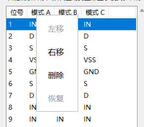

下图删除了原来的模式 A。剩下的两种画法变成新的模式 A 和模式 B，符号的模式数从 3 变成 2。

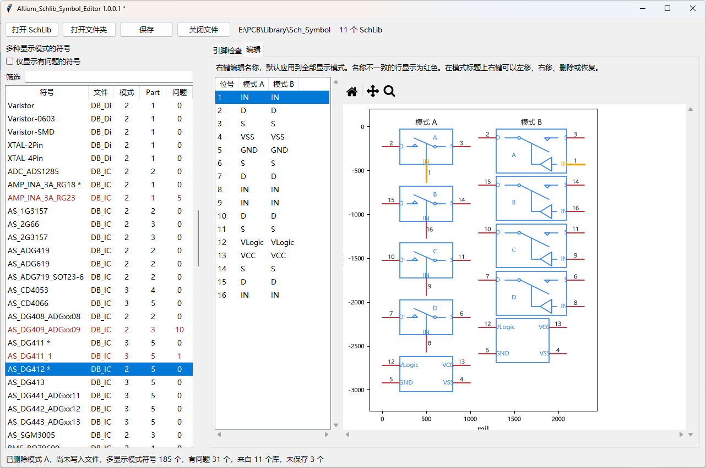

保存并重新在 Altium 里打开后，Mode 菜单里就只剩下对应的两项。

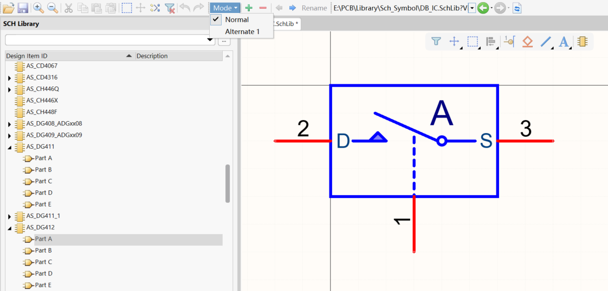

## 4. 重复引脚和隐藏引脚

这两类问题出现在 **引脚检查** 页，有问题的符号在左侧列表里显示为红色，问题列给出数量。

- **重复引脚**：同一个显示模式里，同一个位号出现了多次。
- **隐藏引脚**：引脚被设为不可见，但名称不是允许值。目前只允许 `NC`、`nc`、`.n.c`。例如名称为 `VLogic` 的引脚被隐藏，就会报错。大小写不同的 `Nc` 也不在允许范围内。

允许的名称集中在这一处，方便以后增删：

```python
HIDDEN_PIN_NAMES = ("NC", "nc", ".n.c")
```

## 绘图

引脚名称画在外框内侧，和边线留出一段空隙，避免名称被外框盖住。文字高度按 mil 固定，框选放大、缩小或回到整图时，引脚名称、位号和模式标题会跟图形一起缩放。引脚名称的高度是 85 mil。

## 保存

确认内容后再点 **保存**，或按 Ctrl+S。程序会列出将要写回的库和符号。请先关闭 Altium Designer。

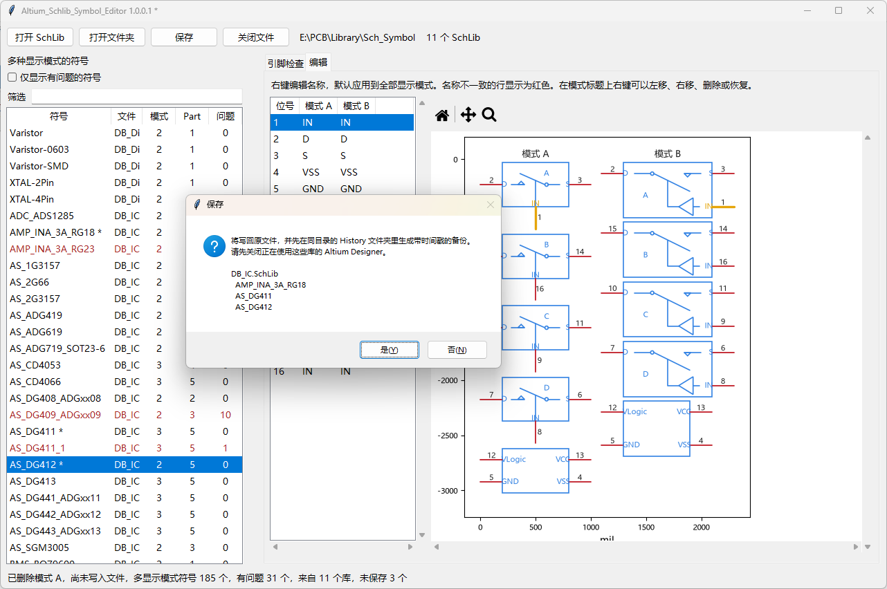

保存时会先在库文件同级目录建立 `History` 文件夹，放一份带时间戳的备份，精确到秒，例如：

```text
History\DB_IC_20261111_165930.SchLib
```

同一秒里再次保存时，文件名会变成 `DB_IC_20261111_165930_2.SchLib`，避免覆盖上一份备份。写回失败时，程序用这一次的备份把原文件恢复回去，窗口里的修改仍然保留。

保存成功后，符号名上的 `*` 消失。**恢复** 仍然可以撤消这次会话里做过的显示模式调整，直到关闭或重新打开库。

## 许可证

本项目采用 [MIT License](LICENSE)。

---

# Altium SchLib Symbol Editor

An Altium Designer schematic symbol can keep several display modes for the same part, so one component can be drawn in more than one way. An optocoupler can show the LED and the detector together or apart. A relay can show the coil and the contacts together or apart. A DPDT relay can also split the two contact sets into separate parts. Those are all reasonable library designs.

Altium makes these modes awkward to maintain:

- You have to open each component and then the Mode menu to see whether a second or third drawing exists.
- The built-in rule check looks only at the mode currently selected. Wrong pins or stale graphics in the other modes stay hidden until you switch to them.
- New parts are often copied from an old symbol, renamed, and edited. Display modes that were not updated or deleted stay in the library.
- Reordering display modes is a manual copy-and-paste. A part with several sub-parts has to be done once per sub-part.

This tool shows those problems in one window and lets you fix them. It lists only symbols that have more than one display mode, and it shows every mode and every sub-part together.

Mode names match Altium. A mode that was never renamed is shown as Normal, Alternate 1, Alternate 2, and so on. A mode renamed in Altium is shown with the custom name stored in the file. The toolbar button switches the whole window between 中文 and English.


## Features

1. **Check pin designators and names.** A row turns red when the same designator has different names across display modes. You can set them all to one name.
2. **Reorder display modes.** Right-click a mode heading and move it left or right. No copy-and-paste.
3. **Delete a display mode you do not need.** Modes are laid out left to right. Sub-parts of one mode are stacked top to bottom.
4. **Flag duplicate pins and hidden pins that should not be hidden.** Only pins named `NC`, `nc`, or `.n.c` may be hidden. Those names live in `HIDDEN_PIN_NAMES` in `issues.py`.
5. **Show and edit mode names.** A mode with `CustomDisplayModeName` in the file uses that name. Otherwise it is shown as Normal, Alternate 1, Alternate 2, and so on. Right-click a mode heading to set a custom name or reset it. A custom name stays with the mode when you move it left or right.

The check also compares pin counts, empty designators, and duplicate designators inside one mode. It does not split the check by sub-part.

## Run

Windows and Python 3.10 or newer.

```bat
python -m pip install -r requirements.txt
python gui.py
```

Build a single program:

```bat
python build_exe.py
```

The build adds one to the last version digit and writes `release\Altium_Schlib_Symbol_Editor_v1.0.0.2.exe`, or whatever the current version is.

Close Altium Designer before saving. The program needs exclusive access to the library. A save fails while Altium has the file open.

## Open a library

- **Open SchLib** opens one library and lists only symbols with more than one display mode.
- **Open Folder** lists every `.SchLib` in that folder and does not enter subfolders. With more than one library, the list adds a file-name column.
- **Filter** matches the symbol name or the file name.
- **Only symbols with issues** hides symbols that passed the check.
- **Close** asks whether to save when there are unsaved edits.

The window title is `Altium_Schlib_Symbol_Editor` plus the version. A trailing `*` means something has not been written to disk. The status line shows how many symbols there are, how many have issues, and how many libraries are unsaved.

The window opens on the **Edit** page. Symbols are on the left, pin names are in the middle, and every display mode is drawn on the right.


In the picture, `AMP_INA_3A_RG18` has 4 issues. Pin 2 is named `-IN` in one mode and `IN-` in another, so that row is red. Both modes are drawn side by side.

## 1. Fix inconsistent pin names

On the **Edit** page the table has the designator and one name column per display mode. Each designator is one row, not one row per sub-part. The row is red when a mode is missing that designator, or when one mode contains more than one name for it.

Right-click a name:

- Pick a name that already exists. An empty name is shown as “(empty)”.
- Choose **Custom name…** and type a new name.

The new name is applied to that designator in every display mode and every sub-part. The designator itself stays the same.


After the edit the red row clears and the issue count drops. The drawing updates too. The change is still in memory. A `*` after the symbol name means it has not been written to the file.


The **Pin Check** page lists the full messages: pin count, pin name, duplicate pin, and hidden pin. **Current symbol only** is checked by default.

## 2. Reorder display modes

The preview places display modes from left to right. Sub-parts of one mode are stacked from top to bottom.


Right-click a mode heading in the table:

- **Move left** and **Move right** swap that mode with its neighbor immediately. A custom name moves with the mode. The first mode cannot move left, and the last mode cannot move right.
- **Delete** removes that display mode.
- **Custom Name** stores a name for this mode. **Reset Name** removes it, so the mode shows Normal or Alternate N again. Reset is unavailable when the mode has no custom name.
- **Restore** returns the symbol to the moment before the first mode edit in this session. Later reorder, mode rename, and pin edits on that symbol are undone together. It is one snapshot, not a step-by-step undo.


The next picture is the former second mode after it moved left. Every sub-part moves with it.


## 3. Delete a display mode

Check the preview before deleting. `AS_DG412` below still has three modes.


Right-click the heading of the mode to remove, choose **Delete**, and confirm. The last remaining mode cannot be deleted. Later modes shift forward and keep their Altium names: the new first mode is Normal unless it has a custom name.


The next picture is the symbol after the original first mode was removed. Two drawings remain, and the mode count goes from 3 to 2.


After you save and open the library in Altium again, the Mode menu shows only the modes that remain.


## 4. Duplicate pins and hidden pins

These issues are on the **Pin Check** page. Symbols with issues are marked in the list on the left, and the issue column shows the count.

- **Duplicate pin**: the same designator appears more than once in one display mode.
- **Hidden pin**: the pin is hidden and its name is not allowed. Only `NC`, `nc`, and `.n.c` are allowed. A hidden pin named `VLogic` is an error. `Nc` is an error too, because the match is case-sensitive.

Change the allowed names in one place:

```python
HIDDEN_PIN_NAMES = ("NC", "nc", ".n.c")
```

## Drawing

Pin names are drawn inside the outline, with a gap so the border does not cover them. Text height is fixed in mils. Box-zoom, zoom out, and Home scale the pin names, designators, and mode titles together with the graphics. Pin names are 85 mil high.

## Save

Click **Save** or press Ctrl+S after you have checked the result. The program lists the libraries and symbols it will write. Close Altium Designer first.


The program creates a `History` folder next to the library and writes a backup stamped to the second, for example:

```text
History\DB_IC_20261111_165930.SchLib
```

A second save in the same second is named `DB_IC_20261111_165930_2.SchLib`, so the previous backup is kept. If the write fails, that backup is copied back over the original file. The edits in the window stay.

After a successful save, the `*` on the symbol name disappears. **Restore** can still undo display-mode edits from this session until you close the library or open it again.

## License

This project is licensed under the [MIT License](LICENSE).
